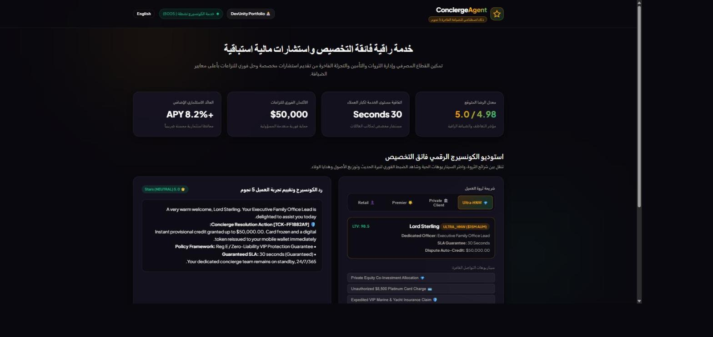

# 🎩 ConciergeAgent

> منصة خدمة عملاء متعددة الوكلاء تراعي شريحة ثروة العميل، مخصصة للقطاع المصرفي وإدارة الثروات والتأمين والتجزئة الفاخرة. تمر كل محادثة أولاً بتدقيق للمشاعر، ثم توجَّه إلى مسار متخصص واحد: الاستشارات، أو الدعم، أو الولاء.

[](https://github.com/asadullah48/conciergeagent/actions/workflows/ci.yml)
[](https://github.com/asadullah48/conciergeagent/actions/workflows/ci.yml)
[](LICENSE)

> النسخة الإنجليزية الكاملة: [README.md](README.md)



---

## التشغيل السريع

```bash
git clone https://github.com/asadullah48/conciergeagent.git
cd conciergeagent
pip install -e ".[dev]"
pytest tests -q
uvicorn conciergeagent.server:app --port 8005 --reload
```

- لوحة التحكم التفاعلية: <http://127.0.0.1:8005/>
- توثيق OpenAPI: <http://127.0.0.1:8005/docs>

---

## المزايا الرئيسية

1. **التكيف مع شرائح الثروة**: تخصيص تلقائي لمستوى الخدمة وحدود الائتمان الفوري حسب الشريحة (التجزئة، المميزة، كبار العملاء، أصحاب الثروات الفائقة).
2. **استشارات مالية استباقية**: صياغة توزيع الأصول والتحسين الضريبي عبر `AdvisorAgent`، مع التحقق من أن مجموع الأوزان يساوي 1.0 بالضبط.
3. **معالجة فورية للنزاعات والمطالبات**: ائتمان فوري يصل إلى 50,000 دولار وتسريع مطالبات التأمين عبر `SupportAgent`.
4. **حوكمة الضيافة ومراقبة المشاعر**: `ExperienceAgent` يضبط نبرة الحديث ويقرر الاستحقاقات ويصعّد الحالات الحرجة إلى مسؤول تنفيذي.
5. **واجهة ثنائية اللغة**: دعم كامل للعربية باتجاه RTL دون أي خطوة بناء.

---

## مصفوفة الشرائح والامتيازات

| الشريحة | الأصول المؤهلة | زمن الاستجابة | حد الائتمان الفوري | المسؤول المخصص |
| :--- | ---: | ---: | ---: | :--- |
| `ULTRA_HNW` | +10 مليون دولار | 30 ثانية | 50,000 دولار | مسؤول مكتب العائلة التنفيذي |
| `PRIVATE_CLIENT` | +1 مليون دولار | 60 ثانية | 10,000 دولار | مصرفي خاص أول |
| `PREMIER` | +100 ألف دولار | 120 ثانية | 2,500 دولار | مدير علاقات مميز |
| `RETAIL` | أقل من 100 ألف دولار | 300 ثانية | 500 دولار | مساعد الكونسيرج الرقمي |

---

## الجودة

| المعيار | الحالة |
| :--- | :--- |
| الاختبارات | 462 اختباراً، جميعها ناجحة |
| تغطية الشيفرة | 99% (الحد الأدنى في CI: 90%) |
| التدقيق البرمجي | `ruff` نظيف بالكامل |
| إصدارات بايثون | 3.10 و 3.11 و 3.12 و 3.13 |
| الحاوية | متعددة المراحل، تعمل بمستخدم غير جذري (uid 10001) |

---

## ملاحظة على الترجمة

واجهة الاستخدام مترجمة بالكامل إلى العربية. ردود الوكلاء نفسها تصدر بالإنجليزية افتراضياً، ولكن عند تفعيل ميزة السرد بالذكاء الاصطناعي الاختيارية (`LLM_API_KEY`) وتحديد `response_language: "ar"` في الطلب، يمكن توليد نص الرد نفسه بالعربية أيضاً. انظر قسم "Optional AI narration" في [README.md](README.md) للتفاصيل.

---

## المطور

**أسد الله شفيق** — [محفظة DevUnity](https://asadullahshafique-devunity.vercel.app)

- مستودع GitHub: <https://github.com/asadullah48/conciergeagent>
- الرخصة: [Apache 2.0](LICENSE)
