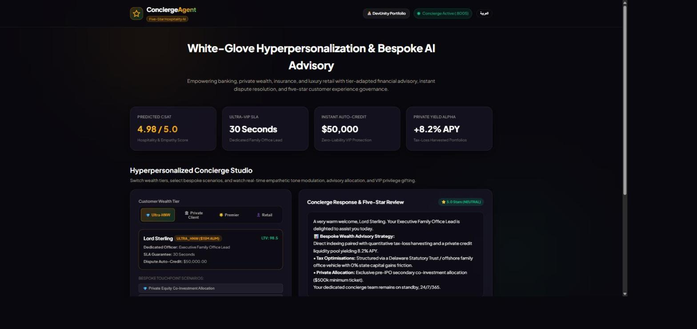
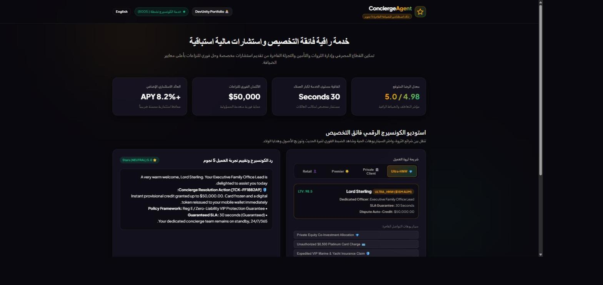

# 🎩 ConciergeAgent

> A tier-aware, multi-agent customer service platform for banking, private wealth, insurance, and luxury retail — routing every interaction through a sentiment audit, then to a specialist advisory, support, or loyalty lane.

[](https://github.com/asadullah48/conciergeagent/actions/workflows/ci.yml)
[](https://github.com/asadullah48/conciergeagent/actions/workflows/ci.yml)
[](https://github.com/asadullah48/conciergeagent/actions/workflows/ci.yml)
[](https://www.python.org/)
[](LICENSE)
[](https://asadullahshafique-devunity.vercel.app)



---

## Run it in 30 seconds

```bash
git clone https://github.com/asadullah48/conciergeagent.git
cd conciergeagent
pip install -e ".[dev]"
pytest tests -q                                                  # 462 passing
uvicorn conciergeagent.server:app --port 8005 --reload
```

Then open **<http://127.0.0.1:8005/>** for the dashboard, or **<http://127.0.0.1:8005/docs>** for the OpenAPI explorer.

Prefer containers? `docker compose up --build` serves the same thing on port 8005.

---

## One request, end to end

```bash
curl -X POST http://127.0.0.1:8005/api/v1/concierge/interact \
  -H 'Content-Type: application/json' \
  -d '{
        "customer_profile": {
          "customer_id": "CUST-9F2A",
          "name": "Lord Sterling",
          "wealth_tier": "ULTRA_HNW",
          "assets_under_management_usd": 15000000.0
        },
        "user_query": "Structure a tax-efficient allocation with pre-IPO exposure.",
        "intent_category": "ADVISORY"
      }'
```

```jsonc
{
  "session_id": "SES-156E861F",          // deterministic: same input, same id, always
  "wealth_tier": "ULTRA_HNW",
  "intent_routed": "ADVISORY",           // which lane actually handled it
  "concierge_response_text": "A very warm welcome, Lord Sterling. Your Executive Family Office Lead …",
  "advisory_recommendation": {
    "portfolio_allocation": {            // validated to sum to exactly 1.0
      "Global Private Equity & VC": 0.30,
      "Hedging & Real Assets": 0.20,
      "Tax-Exempt Fixed Income": 0.25,
      "Global Equities": 0.20,
      "Liquidity / Yield Reserve": 0.05
    }
  },
  "experience_review": { "sentiment_grade": "NEUTRAL", "hospitality_rating": 5 },
  "narration_mode": "DETERMINISTIC",     // "LLM_NARRATED" once LLM_API_KEY is set
  "csat_predicted_score": 4.95,
  "execution_time_ms": 0.31
}
```

---

## How it works

Every interaction is audited for sentiment first, then routed to exactly one specialist lane. The declared `intent_category` is authoritative — the engine does not second-guess the caller by scanning the query text.

```
                        Customer interaction
                                 │
                    ┌────────────▼─────────────┐
                    │  PersonalizationEngine   │   sentiment grade
                    │  + tier privilege matrix │   + SLA / credit limit
                    └────────────┬─────────────┘
                                 │
                    ┌────────────▼─────────────┐
                    │     ExperienceAgent      │   hospitality audit,
                    │   (always runs, first)   │   entitlement, escalation
                    └────────────┬─────────────┘
                                 │
        ┌────────────────────────┼────────────────────────┐
        ▼                        ▼                        ▼
┌───────────────┐      ┌──────────────────┐      ┌────────────────┐
│ AdvisorAgent  │      │   SupportAgent   │      │  Loyalty lane  │
│   ADVISORY    │      │     SUPPORT      │      │    LOYALTY     │
│ allocation,   │      │ dispute credit,  │      │ recognition &  │
│ tax framing   │      │ claims triage    │      │ points review  │
└───────┬───────┘      └────────┬─────────┘      └───────┬────────┘
        └───────────────────────┼────────────────────────┘
                                ▼
              Assembled reply + entitlement + predicted CSAT
```

### Tier privilege matrix

| Tier | Qualifying AUM | SLA | Auto-credit limit | Dedicated officer |
| :--- | ---: | ---: | ---: | :--- |
| `ULTRA_HNW` | $10M+ | 30s | $50,000 | Executive Family Office Lead |
| `PRIVATE_CLIENT` | $1M+ | 60s | $10,000 | Senior Private Banker |
| `PREMIER` | $100K+ | 120s | $2,500 | Premier Relationship Manager |
| `RETAIL` | < $100K | 300s | $500 | Digital Concierge Assistant |

---

## Design decisions worth a look

These are the parts a reviewer tends to find interesting.

**Service recovery and loyalty rewards are different instruments.**
Conflating them produced a perverse incentive — an angry customer out-earned a delighted one. `core/loyalty_policy.py` splits them: recovery is remediation owed regardless of tier because the failure was ours; a reward is discretionary marketing spend gated on tier. Being upset and being pleased now draw on different budgets and can no longer be compared as prizes.

**Identifiers are reproducible, not hashed.**
Session and ticket IDs use BLAKE2b rather than the builtin `hash()`, which CPython seeds randomly per process — the same query used to produce a different ticket on every restart. A test spawns three subprocesses under `PYTHONHASHSEED=random` to prove it stays fixed.

**Invariants live in the type, not in a comment.**
`AdvisoryRecommendation` refuses to exist unless its weights sum to `1.0`; sentiment is clamped to `[-1.0, 1.0]`; an unknown intent is a `422`, not a silent fallthrough. FastAPI publishes every constraint into `/docs` for free.

**CORS is an allowlist.**
`allow_origins=["*"]` combined with `allow_credentials=True` lets any site call the API on a signed-in user's behalf. Origins come from `ALLOWED_ORIGINS`, and a whitespace-only value falls back to the defaults rather than silently allowing nothing.

**Five runtime dependencies.**
Configuration, structured JSON logging, and Prometheus metrics are all stdlib. `/metrics` serves real counters and a latency histogram without a client library.

---

## Bilingual interface

The dashboard ships English and Arabic with full RTL layout and no build step — plain HTML, CSS, and JavaScript served straight from the package.



> **Known limitation:** without AI narration active, agent responses render in English only — the dashboard chrome is fully localised regardless. Set `response_language: "ar"` alongside `LLM_API_KEY` (below) to have the generated reply itself produced in Arabic too.

---

## Optional AI narration (free-tier)

Every reply above is produced entirely by the deterministic rule engine — the tier SLA, the credit amount, the ticket reference, the allocation weights are all computed before a single word of prose exists. Set `LLM_API_KEY` and a model then *restates* that same, already-decided reply in warmer, more natural language. Leave it unset and nothing changes — that's the default, and what the test suite and this README's examples assume throughout.

```bash
# Any OpenAI-compatible /chat/completions endpoint works. Groq's free tier
# (console.groq.com/keys) needs no card and is fast enough for a 30-second
# concierge SLA, so it's the default - but nothing here is Groq-specific.
export LLM_API_KEY=gsk_...
export LLM_MODEL=llama-3.3-70b-versatile
```

Prefer to run fully local instead of a hosted free tier? Point the same client at Ollama — no code changes, just different environment variables:

```bash
ollama pull llama3.1
export LLM_BASE_URL=http://localhost:11434/v1
export LLM_MODEL=llama3.1
export LLM_API_KEY=ollama   # Ollama ignores the value; the client just requires one
```

**The model is a renderer, never a decision-maker.** Every currency amount, percentage, ticket reference, and SLA guarantee in the deterministic reply is extracted with regex and checked against the model's output before it ships; if a single value was dropped, rounded, or invented, the narration is discarded and the deterministic reply is served instead. A model cannot quietly turn `$50,000.00` into `$500,000.00` and have it reach a client. The response's `narration_mode` field always reports which path ran (`LLM_NARRATED`, `LLM_FALLBACK_UNAVAILABLE`, `LLM_FALLBACK_UNFAITHFUL`, or `DETERMINISTIC`), the dashboard surfaces it next to the reply, and a fallback is always visible — never silent. See `conciergeagent/llm/` and its guardrail tests in [`tests/test_narrator.py`](tests/test_narrator.py) and [`tests/test_llm_client.py`](tests/test_llm_client.py).

---

## API surface

| Method | Path | Purpose |
| :--- | :--- | :--- |
| `GET` | `/` | Interactive dashboard |
| `GET` | `/docs` | OpenAPI explorer |
| `GET` | `/healthz` | Liveness probe |
| `GET` | `/readyz` | Readiness probe, lists active agents |
| `GET` | `/metrics` | Prometheus text-format metrics |
| `POST` | `/api/v1/concierge/interact` | Process one interaction |

---

## Quality

| Check | Status |
| :--- | :--- |
| Tests | 462, all passing |
| Statement coverage | 99% (CI floor: 90%) |
| Lint | `ruff` clean, zero suppressions |
| Python versions | 3.10, 3.11, 3.12, 3.13 in CI |
| Container | Multi-stage, non-root (uid 10001), read-only root filesystem |
| CI | Lint → tests → Docker image booted and smoke-tested |

The Docker CI job does not merely build the image: it starts the container, polls `/healthz`, POSTs a real interaction, and asserts on the response. A build-only check passes even when the app crashes on boot.

---

## Deployment

**Vercel** — `vercel.json` and `api/index.py` are included; the whole gateway runs as one serverless function.

```bash
npm i -g vercel && vercel --prod
```

**Docker** — `docker compose up --build`, or build directly:

```bash
docker build -t conciergeagent:latest .
docker run -p 8005:8005 conciergeagent:latest
```

**Kubernetes** — a Helm chart lives in `helm/`, with security contexts, environment wiring, and Prometheus scrape annotations.

```bash
helm install concierge ./helm
```

Configuration is environment-driven; see [`.env.example`](.env.example) for every variable.

---

## Documentation

| Document | Contents |
| :--- | :--- |
| [`SPEC.md`](SPEC.md) | Problem statement, tier matrix, escalation tree |
| [`CHANGELOG.md`](CHANGELOG.md) | What changed and why |
| [`CONTRIBUTING.md`](CONTRIBUTING.md) | Setup, expectations, project layout |
| [`SECURITY.md`](SECURITY.md) | Threat model, controls, known limitations |
| [`README.ar.md`](README.ar.md) | Arabic overview |

---

## About

Built by **Asadullah Shafique** — [DevUnity portfolio](https://asadullahshafique-devunity.vercel.app)

Related projects: [ContextX](https://github.com/asadullah48/contextx) · [GuardrailAI](https://github.com/asadullah48/guardrailai) · [MarketAgentHub](https://github.com/asadullah48/marketagenthub) · [WorkforceAI](https://github.com/asadullah48/workforceai) · [DomainX](https://github.com/asadullah48/domainx)

Licensed under [Apache 2.0](LICENSE).
---

## Author

Built by **Asadullah Shafique** — [portfolio](https://asadullahshafique-devunity.vercel.app) · [GitHub](https://github.com/asadullah48)

