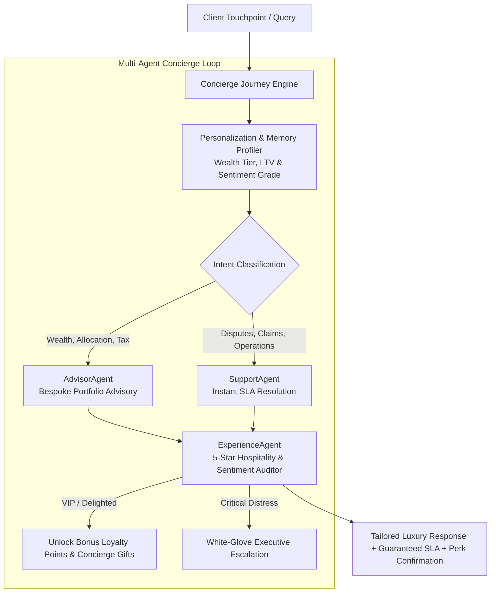

# ConciergeAgent: Hyperpersonalized Service AI Specification

## 1. Executive Summary & Problem Formulation

Modern high-value consumers across Banking, Wealth Management, Insurance, and Luxury Retail expect bespoke, white-glove treatment. However, existing conversational AI bots suffer from:
1. **Generic, Impersonal Scripts**: One-size-fits-all responses that alienate high-net-worth and VIP clients.
2. **Slow Escalation in Distressed Scenarios**: Unresponsive handling of fraud, disputed charges, and insurance emergencies leading to client churn.
3. **Siloed Advisory & Support Functions**: Inability to synthesize wealth growth strategies alongside instant issue resolution.

**ConciergeAgent** implements a **hyperpersonalized, tier-aware multi-agent architecture** delivering five-star hospitality, proactive financial advisory, and instant dispute resolution.

---

## 2. Customer Journey & Multi-Agent Flow



---

## 3. Wealth Tier SLA & Privilege Matrix

| Wealth Tier | Qualifying AUM / Spend | SLA Guarantee | Auto-Credit Dispute Limit | Dedicated Service Desk | VIP Loyalty Gifting |
| :--- | :--- | :--- | :--- | :--- | :--- |
| **`ULTRA_HNW`** | $\$10,000,000+$ | **30 Seconds** | $\$50,000.00$ | Executive Family Office Lead | Private Jet & Dining Concierge |
| **`PRIVATE_CLIENT`** | $\$1,000,000+$ | **60 Seconds** | $\$10,000.00$ | Senior Private Banker | Luxury Lounge & 5,000 Pts |
| **`PREMIER`** | $\$100,000+$ | **120 Seconds** | $\$2,500.00$ | Premier Relationship Manager | Rate Bonus (+0.65%) |
| **`RETAIL`** | $<\$100,000$ | **300 Seconds** | $\$500.00$ | Digital Concierge Assistant | 1,000 Reward Points |

---

## 4. Sentiment Grade & Escalation Tree

```
  [Sentiment Grade] ────────────> [ExperienceAgent Action]
  
  • DELIGHTED (+0.95)   ───────> Award VIP Loyalty Points & Luxury Access
  • POSITIVE (+0.70)    ───────> Warm Proactive Concierge Closing
  • NEUTRAL (0.00)      ───────> Standard 5-Star Hospitality Greeting
  • FRUSTRATED (-0.40)  ───────> Empathetic Apology + Priority Account Credit ($250)
  • CRITICAL (-0.90)    ───────> Sincere Ownership + Immediate Executive Handover Ticket
```

---

## 5. Multi-Agent Topology & Responsibilities

| Agent Name | Core Specialty | Key Performance Metric |
| :--- | :--- | :--- |
| **`AdvisorAgent`** | Customized asset allocations, tax optimization, private co-investments. | Advisory Relevance & Alpha Yield. |
| **`SupportAgent`** | Instant dispute credits, expedited claims triage, policy modifications. | Mean Time to Resolution ($MTTR < 60s$). |
| **`ExperienceAgent`** | Tone modulation, hospitality auditing, loyalty perks, escalation triggers. | Net Promoter Score ($NPS > 88$). |
